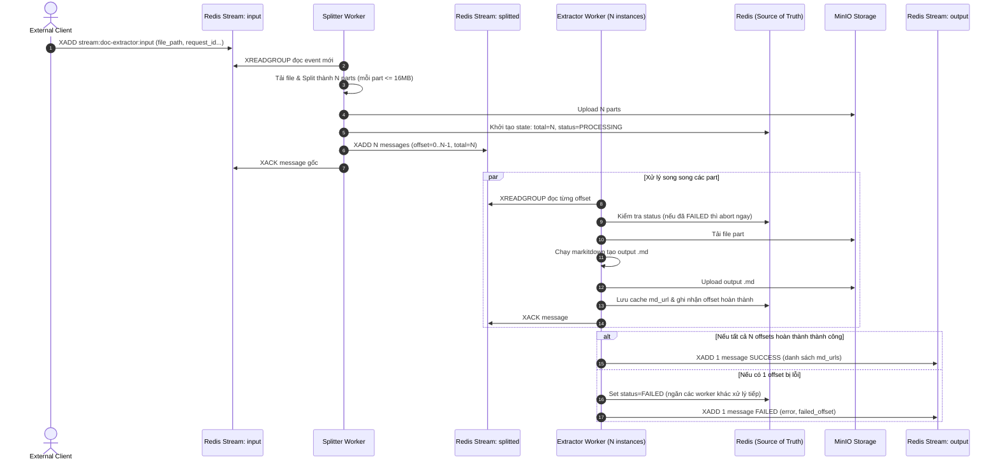

# Functional & Technical Requirement: Event-Driven Document Pipeline (POC)

Tài liệu yêu cầu kỹ thuật chi tiết để chuyển đổi hệ thống xử lý tài liệu sang mô hình **Event Sourcing / Event-Driven Architecture** sử dụng **Redis Streams**, phục vụ lập kế hoạch và triển khai cho Codex.

---

## 1. Mục tiêu (Objective)

Xây dựng hệ thống pipeline xử lý tài liệu bất đồng bộ (Asynchronous Event-Driven Pipeline) theo mô hình Producer-Consumer qua Redis Streams:
- **Tách rời (Decoupling):** Client không bị block HTTP timeout khi xử lý file lớn (> 50MB).
- **Phân tán & Song song hóa (Scalable Workers):** Splitter chia nhỏ tài liệu, sau đó nhiều Extractor worker có thể xử lý song song các part (offset) cùng lúc.
- **Redis làm Single Source of Truth:** Quản lý trạng thái xử lý từng part, bảo đảm tính nhất quán (atomic), phát hiện hoàn thành (all offsets completed) hoặc ngắt sớm khi có lỗi (fail-fast / short-circuit).

---

## 2. Kiến trúc tổng thể & Luồng sự kiện (Sequence Flow)



---

## 3. Đặc tả Redis Streams & Data Schemas

### 3.1. Stream 1: Input (`stream:doc-extractor:input`)
- **Consumer Group:** `cg:doc-splitter`
- **Mục đích:** Tiếp nhận yêu cầu xử lý tài liệu từ external client.
- **Payload Schema (Key-Value trong Stream hoặc JSON field `data`):**
  ```json
  {
    "request_id": "<uuid>",
    "conversation_id": "<uuid>",
    "message_id": "<uuid>",
    "file_path": "http://minio:9000/dataset/sample_50mb.pdf"
  }
  ```

---

### 3.2. Stream 2: Splitted (`stream:doc-extractor:splitted`)
- **Consumer Group:** `cg:doc-extractor`
- **Mục đích:** Phân phối các file con (parts) đã được chia nhỏ cho các Extractor worker.
- **Payload Schema:**
  ```json
  {
    "request_id": "<uuid>",
    "conversation_id": "<uuid>",
    "message_id": "<uuid>",
    "offset": 0,
    "total": 4,
    "file_path": "http://minio:9000/split-files/splits/<conv_id>/<msg_id>/<req_id>/part-001.pdf"
  }
  ```
  *(Trường hợp file gốc $\le 16\text{MB}$ không cần cắt, Splitter phát 1 message duy nhất với `offset: 0`, `total: 1`, `file_path: <original_path>`)*.

---

### 3.3. Stream 3: Output (`stream:doc-extractor:output`)
- **Mục đích:** Thông báo kết quả cuối cùng cho external client / downstream services.
- **Schema khi THÀNH CÔNG (SUCCESS):**
  ```json
  {
    "request_id": "<uuid>",
    "conversation_id": "<uuid>",
    "message_id": "<uuid>",
    "status": "SUCCESS",
    "total": 4,
    "markdown_urls": [
      "http://minio:9000/split-files/splits/.../part-000.md",
      "http://minio:9000/split-files/splits/.../part-001.md",
      "http://minio:9000/split-files/splits/.../part-002.md",
      "http://minio:9000/split-files/splits/.../part-003.md"
    ],
    "completed_at": 1731580000
  }
  ```
- **Schema khi THẤT BẠI (FAILED):**
  ```json
  {
    "request_id": "<uuid>",
    "conversation_id": "<uuid>",
    "message_id": "<uuid>",
    "status": "FAILED",
    "failed_offset": 2,
    "error": "markitdown conversion timed out or file corrupted",
    "failed_at": 1731580000
  }
  ```

---

## 4. Redis làm Source of Truth & Logic State Management

Để bảo đảm tính chính xác khi nhiều worker chạy song song (concurrency / race-condition), hệ thống quản lý trạng thái của mỗi `request_id` trên Redis như sau:

### 4.1. Thiết kế Key trong Redis
1. **Hash metadata:** `doc-extractor:state:{request_id}`
   - `total`: Tổng số part ($N$).
   - `status`: `PROCESSING` | `COMPLETED` | `FAILED`.
   - `failed_reason`: Chuỗi mô tả lỗi (nếu có).
   - `failed_offset`: Offset bị lỗi (nếu có).
2. **Set completed offsets:** `doc-extractor:completed:{request_id}`
   - Lưu tập hợp các offset đã xử lý xong (ví dụ: `0`, `1`, `2`, `3`).
3. **Hash Markdown URLs:** `doc-extractor:parts:{request_id}`
   - `part:0`: URL file `.md` của offset 0 trên MinIO.
   - `part:1`: URL file `.md` của offset 1 trên MinIO.
4. **TTL:** Tất cả các key trên được gán TTL mặc định là **86400 giây (24 giờ)** để tự động giải phóng bộ nhớ.

---

### 4.2. Cơ chế kiểm tra hoàn thành (Atomic Completion Check)
Để tránh race-condition khi 2 worker hoàn thành 2 part cuối cùng cùng một lúc:
- Khi một Extractor hoàn thành `offset`, thực hiện script Lua hoặc Redis Transaction (`MULTI/EXEC`):
  1. Thêm `offset` vào Set `doc-extractor:completed:{request_id}` via `SADD`.
  2. Lưu URL vào `doc-extractor:parts:{request_id}` via `HSET`.
  3. Lấy cardinality của Set via `SCARD`.
  4. Nếu `SCARD == total` và `status == PROCESSING`:
     - Cập nhật `status = COMPLETED`.
     - Trả cờ `is_final_complete = true`.
- Chỉ duy nhất worker nhận được cờ `is_final_complete = true` mới có quyền publish 1 message **SUCCESS** vào `stream:doc-extractor:output`.

---

### 4.3. Cơ chế ngắt sớm khi có lỗi (Fail-Fast / Short-Circuit)
Nếu trong quá trình xử lý có bất kỳ file con nào bị lỗi:
1. Worker phát hiện lỗi lập tức thực hiện lệnh kiểm tra và đổi trạng thái nguyên tử:
   - Nếu `status` hiện tại là `PROCESSING`, chuyển thành `FAILED` (dùng `HSETNX` hoặc Lua script).
   - Nếu đổi thành công (nó là worker đầu tiên gặp lỗi), nó publish đúng **1 message FAILED** vào `stream:doc-extractor:output`.
2. Khi các worker khác chuẩn bị xử lý hoặc đang xử lý các offset còn lại:
   - Bước đầu tiên trước khi tải file: Đọc `status` từ Redis.
   - Nếu `status == FAILED`: Lập tức bỏ qua (abort) tác vụ, không gọi `markitdown`, ACK message và kết thúc sớm để tiết kiệm tài nguyên CPU/RAM.

---

## 5. Đặc tả chi tiết cho từng Worker

### 5.1. Splitter Worker
1. **Khởi động:**
   - Tạo Consumer Group `cg:doc-splitter` trên `stream:doc-extractor:input` nếu chưa có (`XGROUP CREATE ... MKSTREAM`).
   - Lắng nghe sự kiện qua `XREADGROUP GROUP cg:doc-splitter ... STREAMS stream:doc-extractor:input >`.
2. **Xử lý:**
   - Gọi lại logic nghiệp vụ sẵn có trong `usecase.SplitFile` / `services.SplitAndUpload`.
   - Nếu file hợp lệ:
     - Nhận danh sách các URLs từ MinIO (ví dụ $N$ parts).
     - Khởi tạo trạng thái trong Redis: `total = N`, `status = PROCESSING`.
     - Publish $N$ messages vào `stream:doc-extractor:splitted` với `offset = 0 .. N-1`.
   - Nếu file lỗi (ví dụ file OLE `.doc`/`.xls` vượt 16MB hoặc URL không tải được):
     - Publish ngay 1 message FAILED vào `stream:doc-extractor:output`.
3. **Hoàn tất:** Gọi `XACK` message tương ứng trên `stream:doc-extractor:input`.

---

### 5.2. Extractor Worker
1. **Khởi động:**
   - Tạo Consumer Group `cg:doc-extractor` trên `stream:doc-extractor:splitted` nếu chưa có.
   - Lắng nghe qua `XREADGROUP GROUP cg:doc-extractor ... STREAMS stream:doc-extractor:splitted >`.
2. **Xử lý từng message:**
   - **Step 1 (Pre-check):** Đọc `status` từ `doc-extractor:state:{request_id}`. Nếu đã là `FAILED` $\rightarrow$ `XACK` và bỏ qua.
   - **Step 2 (Download):** Tải file part từ `file_path` (MinIO).
   - **Step 3 (Convert):** Gọi `markitdown` thực thi trích xuất sang Markdown (giới hạn timeout xử lý).
   - **Step 4 (Upload MinIO):** Lưu nội dung markdown thành file `.md` trên MinIO (đặt tên: `splits/.../part-{offset}.md`).
   - **Step 5 (Atomic State Update):** Lưu `md_url` và ghi nhận `offset` vào Redis.
   - **Step 6 (Check Finish):**
     - Nếu `completed == total` $\rightarrow$ Đọc toàn bộ danh sách `markdown_urls` theo đúng thứ tự offset và publish 1 message **SUCCESS** vào `stream:doc-extractor:output`.
3. **Xử lý lỗi:**
   - Nếu Step 2, 3 hoặc 4 thất bại: kích hoạt cơ chế Fail-Fast (mục 4.3), publish 1 message **FAILED** vào `stream:doc-extractor:output`.
4. **Hoàn tất:** Gọi `XACK` message trên `stream:doc-extractor:splitted`.

---

## 6. Tiêu chí nghiệm thu (Acceptance Criteria cho Codex)

- [ ] **AC-1 (Redis Streams Setup):** Tự động khởi tạo đầy đủ 3 streams và 2 consumer groups khi service khởi chạy.
- [ ] **AC-2 (Splitter Flow):** Đọc message từ `stream:doc-extractor:input`, chia file và bắn đúng $N$ messages có `offset` (từ $0$ đến $N-1$) và `total` vào `stream:doc-extractor:splitted`.
- [ ] **AC-3 (Extractor Flow):** Đọc từng part từ `stream:doc-extractor:splitted`, chạy `markitdown`, upload file `.md` lên MinIO và lưu vết vào Redis.
- [ ] **AC-4 (Source of Truth & Aggregation):** Khi toàn bộ $N$ offsets hoàn thành, chỉ bắn duy nhất **1 message SUCCESS** vào `stream:doc-extractor:output` chứa danh sách đầy đủ URLs markdown theo đúng thứ tự.
- [ ] **AC-5 (Fail-Fast on Error):** Nếu có 1 part bị lỗi (ví dụ cố tình truyền file hỏng hoặc timeout), bắn đúng **1 message FAILED** vào `stream:doc-extractor:output`, đồng thời các part còn lại của `request_id` đó phải dừng xử lý ngay lập tức.
- [ ] **AC-6 (No Memory Leaks / Streaming):** Workers không lưu trữ toàn bộ dữ liệu trong bộ nhớ RAM, duy trì footprint ổn định dưới ngưỡng container limits.
- [ ] **AC-7 (Docker Compose Ready):** Cập nhật `docker-compose.yaml` để các worker có thể chạy độc lập hoặc tích hợp trong hệ thống hiện tại.
