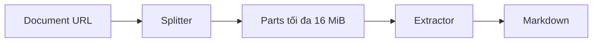

# Overview

go-markitdown chuyển tài liệu từ URL HTTP(S) thành Markdown. Pipeline gồm hai stage: **Splitter** split file lớn thành các part có thể xử lý độc lập; **Extractor** convert từng part bằng Python CLI `markitdown`.

## Runtime modes

| Mode | Cách sử dụng | Output |
|---|---|---|
| `http` — mặc định | Gọi synchronous API cho từng stage | Splitter trả URL; Extractor trả nội dung Markdown |
| `worker` | Gửi event vào Redis Streams | Nhận terminal event chứa Markdown URLs hoặc error |

Docker Compose hiện cấu hình worker mode, theo mô hình 1 Splitter và nhiều Extractor. Client chịu trách nhiệm đưa file lên nơi các worker truy cập được và đọc kết quả từ output stream.

## Scope

- Hỗ trợ PDF, DOCX, XLSX, PPTX, CSV, HTML, EML; DOC/XLS chỉ đi qua bước chia nếu không vượt ngưỡng.
- File không quá **16 MiB** (16 × 1024 × 1024 byte) giữ URL gốc; file lớn dùng format-aware splitting.
- Worker trả ordered list của Markdown URLs theo offset; chưa merge thành một Markdown file.
- Đây là POC; chưa có load-test benchmark để kết luận system capacity.

## Documentation map

- [Architecture & solution design](02-architecture.md)
- [Document splitting flow](03-seq-split-document.md)
- [Extraction & aggregation flow](04-seq-extract-document.md)
- [Failure handling & recovery](05-seq-failure-recovery.md)
- [Synchronous HTTP flow](06-seq-http.md)
- [Benchmark results](07-load-test.md) — để trống đến khi có kết quả.
