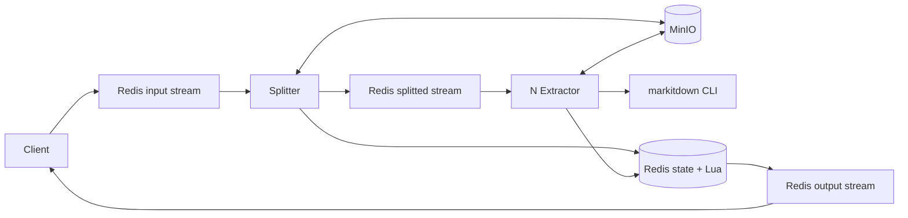
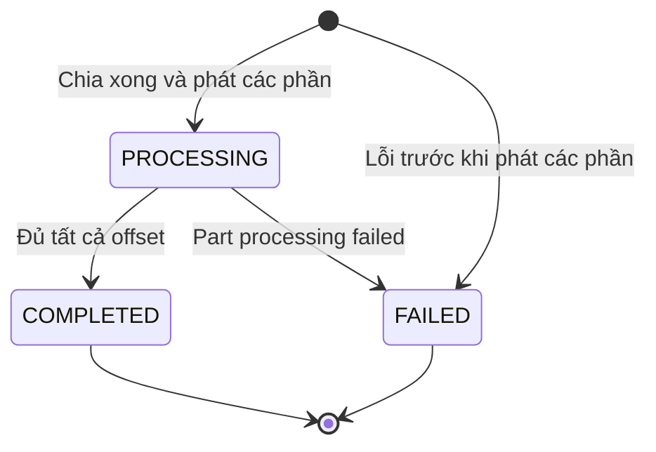

# Architecture

## Components

Source file có thể ở MinIO hoặc một nguồn HTTP(S) khác. Redis chỉ mang metadata và URL; MinIO lưu split parts và Markdown output.

| Component | Responsibility |
|---|---|
| `cmd/splitter`, `cmd/extractor` | Bootstrap binary, chọn runtime mode, quản lý lifecycle |
| `internal/handler` | Nhận và trả HTTP request |
| `internal/usecase` | Orchestrate download, validate size limit, split hoặc convert |
| `internal/services` | Format-aware splitting, chạy subprocess, tích hợp MinIO |
| `internal/pipeline` | Consumer, event contract và state transition qua Lua |

## Solution design

**Fan-out để parallel processing.** Splitter publish một event cho mỗi part. Các Extractor trong cùng consumer group phân phối workload; mỗi process xử lý một message tại một thời điểm. Scale replica giúp tăng concurrency, nhưng throughput thực tế còn phụ thuộc Splitter, CLI, Redis và I/O.

**Format-aware splitting.** Split theo semantic boundary của từng format. Mỗi part cần parse được độc lập và không vượt 16 MiB; chi tiết theo định dạng ở [luồng chia file](03-seq-split-document.md).

**Redis là source of truth cho processing state.** Mỗi `request_id` có state hash, completed-offset set và part-URL hash. Các key dùng chung absolute expiry sau 24 giờ từ lúc tạo state; processing không refresh TTL.

**Atomic state transition qua Lua để xử lý race condition.** Ba Lua script gộp state mutation và event publishing trong cùng execution: initialize + fan-out, record completion + publish `SUCCESS` khi đủ part, hoặc mark + publish `FAILED`. Kiến trúc hiện tại là event-driven pipeline, chưa hỗ trợ event sourcing/replay.

Internal state `COMPLETED` tương ứng terminal event `SUCCESS`. Terminal state không bị late result thay đổi. Idempotency dựa trên state còn tồn tại; deduplication không được bảo đảm sau khi TTL hết hạn.

**Resource bounds qua disk I/O và timeout.** Download và ghi Markdown qua temporary file để tránh giữ toàn bộ content trong Go memory. Default job timeout: Splitter 15 phút, Extractor 5 phút; conversion subprocess timeout 2 phút. Điều này không có nghĩa mọi thư viện chia file hoặc tiến trình Python đều dùng bộ nhớ cố định.

## POC limitations

- Redis Streams giao lại message chưa ACK; xử lý có thể chạy lại. State idempotency không đồng nghĩa download, conversion hay upload chỉ chạy một lần.
- MinIO và Redis không nằm trong cùng transaction: worker chết sau upload có thể để lại orphan object.
- Recovery chỉ drain pending của chính consumer; chưa có automatic reclaim từ consumer đã mất, lease, fencing hoặc deadline sweeper.
- Chưa có tự động trim stream, Redis Cluster hay MinIO object cleanup policy trong luồng này.
- Worker mode chỉ phục vụ `/ping` qua HTTP; probe này kiểm tra tiến trình HTTP đang phản hồi, chưa kiểm tra dependency readiness.

Source references: [pipeline](../internal/pipeline/), [usecase](../internal/usecase/), [services](../internal/services/), [Compose](../deploy/docker-compose.yaml).
