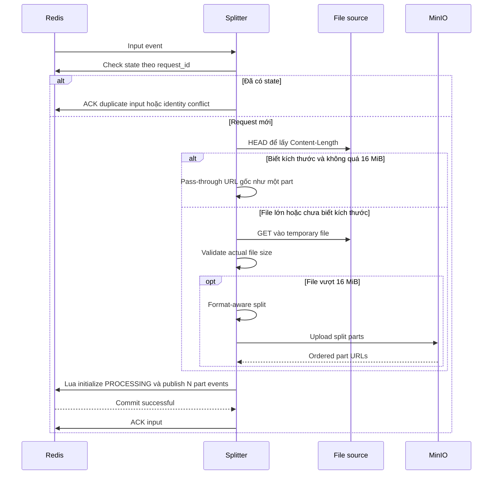

# Document splitting flow

Splitter nhận input chứa `request_id`, `conversation_id`, `message_id` và `file_path`. Ba ID phải là UUID; URL phải là HTTP(S).

Nếu tải về mới biết file nhỏ, Splitter vẫn dùng URL gốc. Phần xử lý lỗi được mô tả [riêng](05-seq-failure-recovery.md).

## Format-aware splitting

| Format | Splitting strategy |
|---|---|
| PDF | Split theo page group; giảm page span nếu part quá lớn; preserve page order |
| CSV | Split theo row, repeat header ở mỗi part |
| DOCX | Split XML theo body block; preserve OOXML package structure và shared resources |
| XLSX | Split theo sheet và row group; mỗi part là single-sheet workbook, remap row coordinates |
| PPTX | Group các slide liên tiếp, giữ required resources và update package manifest |
| HTML | Tokenize, ưu tiên block boundary; close/reopen ancestor tags, strip script/style và embedded binary data |
| EML | Parse MIME; render header/body thành HTML, xử lý attachment riêng và split tiếp khi cần |
| DOC, XLS | Không support splitting cho OLE; reject file vượt size limit |

Nếu atomic unit vẫn vượt giới hạn, luồng trả lỗi thay vì đưa phần quá lớn sang Extractor. EML có thể sinh các phần khác định dạng với file gốc.

Mỗi part event có `offset` bắt đầu từ 0 và `total`. Lua chỉ cho khởi tạo từ 1 đến 1.000 phần. State và toàn bộ part events được commit trong cùng Lua execution, sau khi các upload đã hoàn tất.

Source references: [SplitFile](../internal/usecase/splitfile.go), [splitters](../internal/services/splitter.go), [init_and_publish.lua](../internal/pipeline/lua/init_and_publish.lua).
