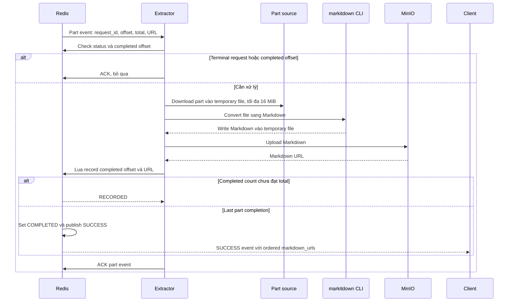

# Extraction & aggregation flow

Các Extractor nhận từng part event từ `stream:doc-extractor:splitted` qua group `cg:doc-extractor`. Không cần chờ các phần trước hoàn tất.

Client đọc output stream; mũi tên trả kết quả thể hiện việc client đọc event, không phải HTTP callback.

## Aggregation không cần coordinator riêng

Redis dùng completed-offset set để deduplicate completion, tránh double counting. Khi số offset bằng `total`, Lua lấy URL theo thứ tự `0..total-1`, phát `SUCCESS` và lưu ID event cuối.

Ví dụ các phần hoàn thành theo thứ tự **2 → 0 → 1**, kết quả vẫn là **URL 0 → URL 1 → URL 2**. Danh sách này dành cho downstream đọc hoặc ghép; pipeline chưa merge Markdown content.

Upload diễn ra trước commit Redis. Nếu Redis gián đoạn sau khi upload, worker retry commit để không phải chuyển đổi lại ngay trong lần xử lý đó. Nếu tiến trình chết, lần chạy lại vẫn có thể tạo upload mới.

Source references: [ExtractorWorker](../internal/pipeline/extractor.go), [complete_part.lua](../internal/pipeline/lua/complete_part.lua).
