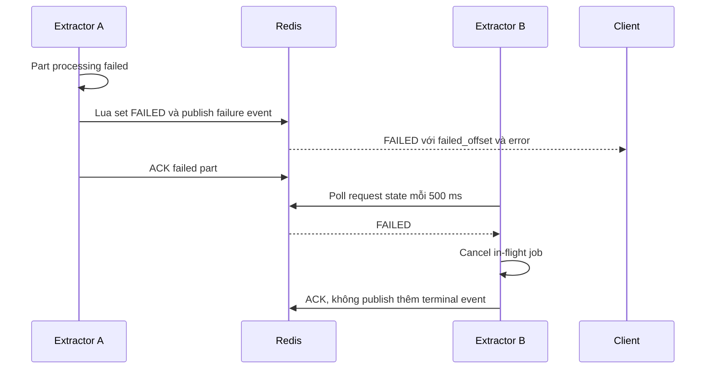

# Failure handling & recovery

## Processing failure: fail-fast

Download, split, conversion, upload error hoặc job timeout được xem là processing failure. Failure đầu tiên được commit hợp lệ sẽ terminate request; không tự retry processing cho request đã `FAILED`.



Lỗi tại Splitter trước khi phát các phần dùng `failed_offset = -1`. Late result sau terminal state bị bỏ qua; nhiều worker cùng báo lỗi cũng không tạo thêm terminal event trong thời gian state còn tồn tại.

Malformed JSON hoặc invalid event được log và ACK, không phát `FAILED`. Part event không còn state cũng được ACK và bỏ qua; vì vậy không phải mọi message đầu vào đều có terminal event.

## Infrastructure failure: retry & recovery

```mermaid
sequenceDiagram
    participant R as Redis
    participant W as Worker
    R->>W: Deliver message, đưa vào pending
    W->>W: Xử lý và upload
    W->>R: Commit state qua Lua
    alt Transient Redis error
        W->>R: Retry commit, backoff 1 giây
    else Commit successful
        R-->>W: Kết quả commit
    end
    Note over W,R: Chỉ ACK sau khi handler xử lý xong
    W->>R: ACK; retry nếu ACK lỗi
    Note over W: Nếu worker crash trước ACK
    W->>W: Restart với cùng CONSUMER_NAME
    W->>R: Drain own pending trước khi đọc message mới
    R-->>W: Message chưa ACK
    W->>R: Check state, resume hoặc skip completed part
    W->>R: ACK
```

Mỗi replica cần unique consumer name, ổn định qua restart để recover own pending. Nếu consumer mất hẳn, hiện cần manual pending transfer; chưa có automatic reclaim.

SIGTERM/SIGINT cancel processing context và dừng consume message mới. Công việc bị ngắt do shutdown không bị đánh dấu `FAILED`; message chưa ACK còn pending cho lần khởi động sau.

Source references: [consumer](../internal/pipeline/consumer.go), [failure script](../internal/pipeline/lua/fail_request.lua), [worker lifecycle](../cmd/extractor/main.go).
