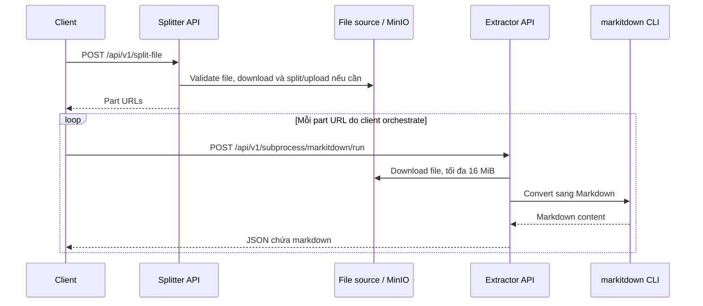

# Synchronous HTTP flow

`SERVICE_MODE=http` chạy API độc lập cho từng binary. Client orchestrate split và conversion; HTTP mode không dùng Redis để aggregate result.

Khác với worker mode, API chuyển đổi trả trực tiếp nội dung Markdown, không upload Markdown lên MinIO. Client có thể gọi API chuyển đổi trực tiếp nếu đã có file không quá giới hạn.

| Endpoint | Binary | Responsibility |
|---|---|---|
| `GET /ping` | Cả hai | Kiểm tra HTTP đang phản hồi; cũng có trong worker mode |
| `POST /api/v1/split-file` | Splitter | Nhận các ID và `file_path`, trả `urls` |
| `POST /api/v1/subprocess/markitdown/run` | Extractor | Nhận `url`, trả `markdown` |
| `POST /api/v1/subprocess/run` | Extractor | Chạy subprocess từ `args`, trả `output` |

Source references: [Splitter entrypoint](../cmd/splitter/main.go), [Extractor entrypoint](../cmd/extractor/main.go), [handlers](../internal/handler/).
