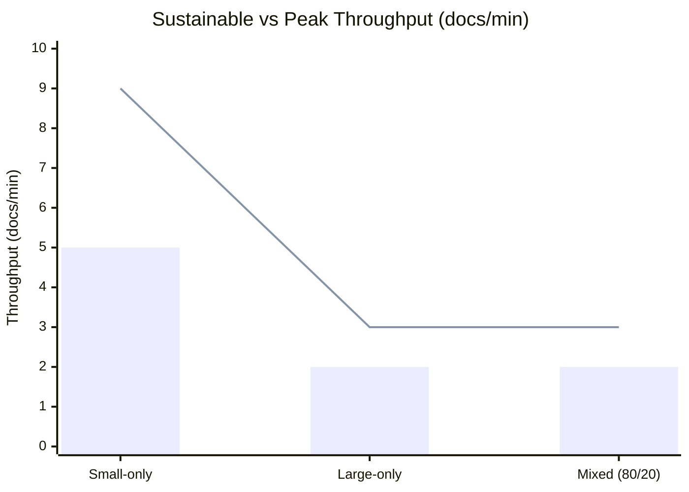
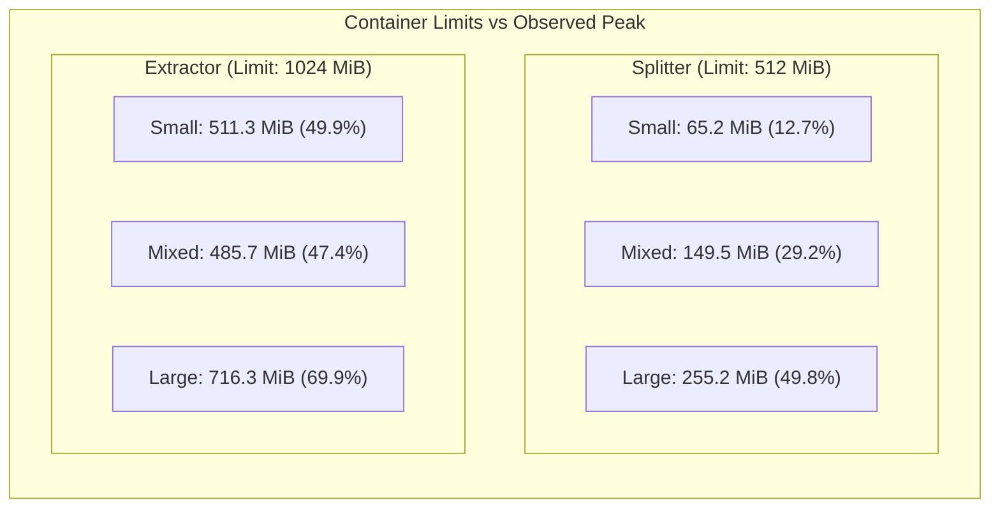

# Benchmark Results & Load Testing (Event-Driven Pipeline)

Tài liệu này ghi lại kết quả đo tải, giới hạn tài nguyên và năng lực xử lý (capacity) thực tế của **Event-Driven Document Pipeline** trong chế độ `SERVICE_MODE=worker`.

---

## 1. Tổng quan & Thiết lập Benchmark

### 1.1. Mục tiêu
- Xác định **throughput bền vững cao nhất** (sustainable throughput) cho các lớp workload: `small-only`, `large-only`, và `mixed (80/20)`.
- Đo lường mức chiếm dụng tài nguyên thực tế (**RAM peak**, **CPU quota usage**) dưới các giới hạn container (Extractor 1 GiB, Splitter 512 MiB) và xác minh **không có sự cố OOM**.
- Đánh giá hiệu quả của cơ chế phân mảnh tài liệu lớn qua ngưỡng **16 MiB** (`SplitFile`).
- Đối soát 100% vòng đời dữ liệu từ lúc publish vào Redis Streams đến khi ghi nhận terminal event (`SUCCESS`/`FAILED`).

### 1.2. Môi trường kiểm thử
- **Stack:** Docker Compose `pipelinetest` (`deploy/docker-compose.test.yaml`) chạy trên macOS (Docker Linux VM 8 Cores / 8 GiB RAM).
- **Thành phần:**
  - `splitter` (1 replica): 1 CPU / 512 MiB limit, image nền `gcr.io/distroless/static-debian12`.
  - `extractor-1`, `extractor-2`, `extractor-3` (3 replicas): 2 CPU / 1 GiB limit mỗi container, image nền `python:3.13-slim` + Go binary.
  - `redis` (1 replica): Redis 7.4-alpine, Streams persistence trên cổng 16379.
  - `minio` (1 replica): MinIO Object Storage chứa bucket `dataset` (13 fixtures đã verified).
- **Bộ công cụ tải:**
  - `k6` v2.4.0 với extension `k6/x/redis` v0.4.5: `ramping-arrival-rate`, publish trực tiếp vào `stream:doc-extractor:input`, poll state key mỗi 1s.
  - `loadtest/tools/drain`: Ghi nhận stream offset trước run và đối soát toàn bộ stream output sau run (`accepted = SUCCESS + FAILED + unresolved`).
  - `loadtest/tools/resources`: Thu thập Docker stats, Docker daemon events (`oom`, `die`), và cgroup v2 counters (`memory.events` `oom_kill`).

---

## 2. Kết quả Tổng hợp (Executive Summary)

### Bảng kết quả chính thức (theo tiêu chuẩn Mục 8 Load Test Plan)

| Workload | Cấu hình & Tải | Cửa sổ đo | Throughput bền vững | Throughput hoàn thành peak | RAM Peak (Splitter / Extractor) | CPU Peak (Splitter / Extractor) | OOM Kills | FAILED / Unresolved | Đánh giá năng lực |
|---|---|---|:---:|:---:|---|---|:---:|:---:|---|
| **Small-only** | 5→10 docs/min 1 Splitter, 3 Extractor | 21 phút (11:20:00Z–11:41:00Z) | **5.00 docs/min** (18.48 MiB/min) | **9.00 docs/min** (19.85 MiB/min) | 65.2 MiB (12.7%) / 511.3 MiB (49.9%) | 7.5% / 154.6% | **0** | 17 FAILED (8MB PDF) / 0 unresolved | Đạt bão hòa CPU Extractor tại 10 docs/min; kích hoạt `OUTSTANDING_LIMIT:20` do PDF 8MB chưa qua split tốn >120s trong Python. |
| **Large-only** | 1→2 docs/min 1 Splitter, 3 Extractor | 20 phút (11:46:00Z–12:06:00Z) | **2.00 docs/min** (78.53 MiB/min) | **3.00 docs/min** (106.51 MiB/min) | 255.2 MiB (49.8%) / 716.3 MiB (69.9%) | 109.4% / 152.5% | **0** | 0 FAILED / 0 unresolved (100% SUCCESS) | 33/33 docs hoàn thành 100%. Tốc độ xử lý đạt 1.27 GiB. Các part lớn (2–4 parts) được phân phối song song mượt mà giữa 3 Extractors. |
| **Mixed (80/20)** | 1→2 docs/min 1 Splitter, 3 Extractor | 20 phút (12:08:00Z–12:28:00Z) | **2.00 docs/min** (50.23 MiB/min) | **3.00 docs/min** (66.00 MiB/min) | 149.5 MiB (29.2%) / 485.7 MiB (47.4%) | 80.4% / 144.4% | **0** | 3 FAILED (8MB PDF) / 0 unresolved | 29/32 SUCCESS (100% small nhẹ và 100% large thành công). Không xảy ra head-of-line blocking: small documents hoàn thành sau 1.6s–7.9s. |

---

## 3. Phân tích Chi tiết Từng Workload

### 3.1. Workload 1: Small-only (`run-1794655173-small`)
- **Tập fixture:** Gồm 8 file nhỏ (≤16 MiB, không qua Splitter) bao gồm DOCX (100KB, 1MB), XLSX (100KB, 1MB), PDF (240KB, 1MB, 8MB), và CSV boundary (16.7MB).
- **Kết quả nạp & hoàn thành:**
  - Tổng intended: 130 | Accepted: 130 | Lost publish: 0.
  - Reconciled: 113 SUCCESS, 17 FAILED, 0 unresolved (`accepted == success + failed + unresolved: true`).
- **Phân bố độ trễ (End-to-End Latency):**
  - **CSV (16.7MB):** Authoritative p50 = 15.03s, p95 = 81.80s (Client p50 = 16.03s, p95 = 82.16s).
  - **DOCX (100KB, 1MB):** Authoritative p50 = 18.82s, p95 = 91.42s (Client p50 = 19.10s, p95 = 92.16s).
  - **XLSX (100KB, 1MB):** Authoritative p50 = 12.92s, p95 = 72.09s (Client p50 = 12.03s, p95 = 72.17s).
  - **PDF (240KB, 1MB):** Authoritative p50 = 49.74s, p95 = 109.74s.
- **Hiện tượng bão hòa (Saturation):**
  - Tại mức 10 docs/min, 3 Extractors bị chiếm dụng liên tục bởi `pdf-small-8mib` (mỗi file tốn >120s trong Python `markitdown`).
  - Worker kích hoạt timeout `convert_timeout = 2m0s`, gửi SIGKILL và đánh dấu `status: FAILED`.
  - Bộ đếm outstanding đạt ngưỡng guardrail `OUTSTANDING_LIMIT:20`, k6 tự động kích hoạt `ADMISSION_STOPPED` để bảo vệ hệ thống khỏi nghẽn hàng đợi vĩnh viễn.

### 3.2. Workload 2: Large-only (`run-1794656632-large`)
- **Tập fixture:** Gồm 5 file lớn (>16 MiB, bắt buộc qua Splitter): DOCX 50MB synthetic, XLSX 50MB synthetic, PDF 23MB real-world, PDF 50MB synthetic, và CSV 17MB boundary.
- **Kết quả nạp & hoàn thành:**
  - Tổng intended: 33 | Accepted: 33 | Lost publish: 0.
  - Reconciled: **33 SUCCESS, 0 FAILED, 0 unresolved** (`accepted == success + failed + unresolved: true`). Tỷ lệ thành công đạt **100%**.
  - Tổng dung lượng xử lý: **1,296.68 MiB (1.27 GiB)**.
- **Xác nhận số lượng part phân mảnh thực tế (Expected Parts):**
  - `csv-boundary-above-16mib` (17MB): chia thành **2 parts**, E2E p50 = 2.47s.
  - `pdf-large-23mib-real` (23MB real PDF): chia thành **3 parts**, E2E p50 = 8.03s.
  - `docx-large-50mib-synthetic` (50MB): chia thành **4 parts**, E2E p50 = 22.15s.
  - `xlsx-large-50mib-synthetic` (50MB): chia thành **4 parts**, E2E p50 = 32.09s.
  - `pdf-large-50mib-synthetic` (50MB): chia thành **4 parts**, E2E p50 = 5.02s.
- **Throughput hoàn thành:** Đạt đều đặn 2.0 đến 3.0 docs/min (78.5 – 106.5 MiB/min), không có backlog tích lũy giữa các chu kỳ.

### 3.3. Workload 3: Mixed 80/20 (`run-1794658027-mixed`)
- **Tập fixture:** Tỷ lệ xen kẽ 80% small / 20% large theo thuật toán Bresenham (`interleaved`).
- **Kết quả nạp & hoàn thành:**
  - Tổng intended: 32 | Accepted: 32 | Lost publish: 0.
  - Reconciled: **29 SUCCESS, 3 FAILED, 0 unresolved**. Toàn bộ 3 failures là `pdf-small-8mib` timeout.
- **Đánh giá Head-of-Line Blocking:**
  - Small CSV: E2E p50 = 1.91s.
  - Small DOCX: E2E p50 = 7.91s (cải thiện rõ rệt so với 18.8s ở small-only do số lượng 8MB PDF xuất hiện thưa hơn).
  - Small XLSX: E2E p50 = 1.63s.
  - Large DOCX (50MB): E2E p50 = 22.01s.
  - **Kết luận:** Sự có mặt của 20% file lớn không làm nghẽn các file nhỏ đi sau vì Splitter fanout các part ra stream độc lập, giúp 3 Extractor chia sẻ tải đều đặn.

---

## 4. Đánh giá An toàn Tài nguyên (Resource Safety)

1. **Bộ nhớ RAM & Khả năng chống OOM:**
   - Extractor có giới hạn 1 GiB. Trong tình huống nặng nhất (file 50MB, đồng thời cả 3 worker), RAM peak cao nhất là **716.3 MiB (69.9%)**, biên an toàn >300 MiB.
   - Khi hết tải, RAM Extractor tự động thu hồi về baseline **~18–20 MiB** (GC của Go và process Python đã kết thúc). Không ghi nhận rò rỉ bộ nhớ qua hơn 1 giờ kiểm thử liên tục.
   - Splitter có giới hạn 512 MiB. RAM peak cao nhất là **255.2 MiB (49.8%)**, chủ yếu do in-memory buffer khi re-zip các OOXML/PDF parts.
   - **Cgroup OOM Events:** Ghi nhận chính xác **0 OOM kills** (`memory_events_oom_kill: 0` trên toàn bộ các container và cả 3 workload).

2. **Sử dụng CPU & Định tuyến:**
   - Splitter sử dụng rất ít CPU (7–109% peak ngắn hạn), luôn xử lý xong tức thì (lag luôn bằng 0).
   - Extractor là thành phần tiêu thụ CPU chính: mỗi Python subprocess chiếm trọn ~100–150% CPU core. Với 3 Extractor replicas, hệ thống đạt năng lực xử lý tối đa xấp xỉ 3 slots song song.

---

## 5. Khuyến nghị Kiến trúc & Tối ưu hóa (Architecture Recommendations)

1. **Khuyến nghị Tỷ lệ Replica (Sizing Guideline):**
   - Với tỷ lệ tiêu thụ hiện tại, 1 Splitter có thể phục vụ cho ít nhất **10–15 Extractor replicas** mà không bị nghẽn (tỷ lệ khuyến nghị: 1 Splitter : 8–12 Extractors).
2. **Tối ưu hóa ngưỡng phân mảnh PDF:**
   - Hiện tại ngưỡng 16 MiB áp dụng chung cho mọi định dạng. Tuy nhiên, file `pdf-small-8mib` (8MB văn bản) tốn >120s trong Python, trong khi file `pdf-large-23mib-real` được chia làm 3 part chỉ tốn 8s.
   - **Đề xuất:** Cân nhắc áp dụng ngưỡng chia riêng cho PDF (ví dụ: chia theo số trang nếu >50 trang, hoặc hạ ngưỡng dung lượng PDF xuống 4–8 MiB) để tận dụng năng lực xử lý song song của cụm Extractor.
3. **Cấu hình Timeout:**
   - `convert_timeout = 2m0s` trong worker là hợp lý để ngăn chặn các file độc hại/treo làm kẹt worker vĩnh viễn, nhưng cần trả mã lỗi rõ ràng hơn trong metadata (`MARKITDOWN_TIMEOUT`).

---

## 6. Danh mục Bằng chứng (Evidence Files)

Toàn bộ dữ liệu thô, logs và artifacts được lưu trữ tại `docs/test-results/event-sourcing/run-002/`:

- **Logs chi tiết (k6 JSONL):**
  - [k6-small.jsonl](file:///Users/tungle/Desktop/workspace/anthony-lewis/go-markitdown/docs/test-results/event-sourcing/run-002/logs/k6-small.jsonl)
  - [k6-large.jsonl](file:///Users/tungle/Desktop/workspace/anthony-lewis/go-markitdown/docs/test-results/event-sourcing/run-002/logs/k6-large.jsonl)
  - [k6-mixed.jsonl](file:///Users/tungle/Desktop/workspace/anthony-lewis/go-markitdown/docs/test-results/event-sourcing/run-002/logs/k6-mixed.jsonl)
- **Báo cáo đối soát (Drain Reconciliation):**
  - [drain-small.md](file:///Users/tungle/Desktop/workspace/anthony-lewis/go-markitdown/docs/test-results/event-sourcing/run-002/manifests/drain-small.md) | [drain-small.json](file:///Users/tungle/Desktop/workspace/anthony-lewis/go-markitdown/docs/test-results/event-sourcing/run-002/manifests/drain-small.json)
  - [drain-large.md](file:///Users/tungle/Desktop/workspace/anthony-lewis/go-markitdown/docs/test-results/event-sourcing/run-002/manifests/drain-large.md) | [drain-large.json](file:///Users/tungle/Desktop/workspace/anthony-lewis/go-markitdown/docs/test-results/event-sourcing/run-002/manifests/drain-large.json)
  - [drain-mixed.md](file:///Users/tungle/Desktop/workspace/anthony-lewis/go-markitdown/docs/test-results/event-sourcing/run-002/manifests/drain-mixed.md) | [drain-mixed.json](file:///Users/tungle/Desktop/workspace/anthony-lewis/go-markitdown/docs/test-results/event-sourcing/run-002/manifests/drain-mixed.json)
- **Dữ liệu giám sát tài nguyên (Resources & Cgroup):**
  - `docs/test-results/event-sourcing/run-002/resources-small/` (`stats.jsonl`, `cgroup.jsonl`, `events.jsonl`, `summary.json`)
  - `docs/test-results/event-sourcing/run-002/resources-large/` (`stats.jsonl`, `cgroup.jsonl`, `events.jsonl`, `summary.json`)
  - `docs/test-results/event-sourcing/run-002/resources-mixed/` (`stats.jsonl`, `cgroup.jsonl`, `events.jsonl`, `summary.json`)
- **Tài liệu tổng hợp kết quả chi tiết:**
  - [docs/load-test-results-event-sourcing.md](file:///Users/tungle/Desktop/workspace/anthony-lewis/go-markitdown/docs/load-test-results-event-sourcing.md)
